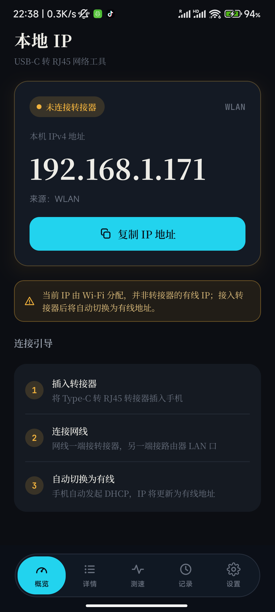
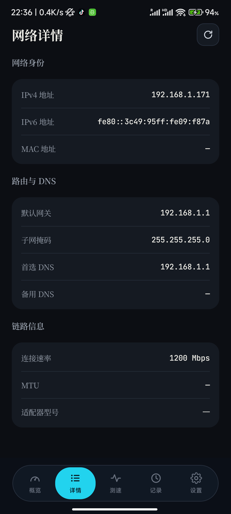
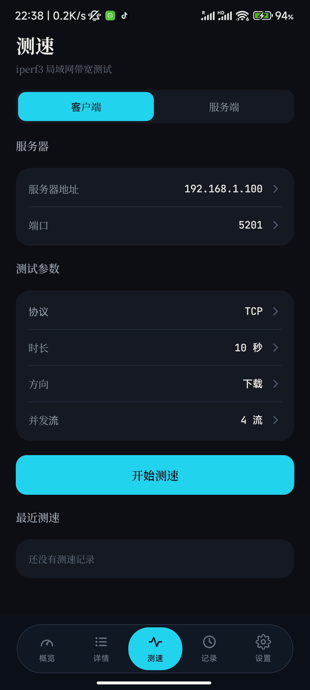
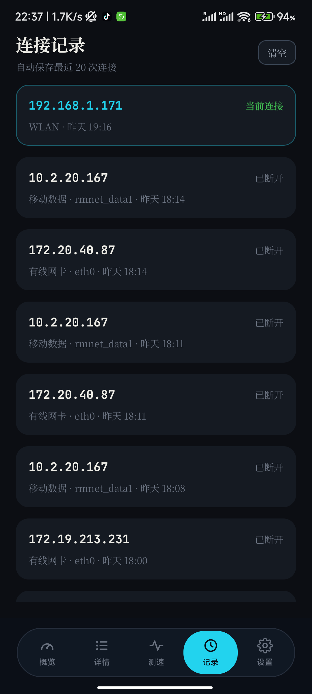
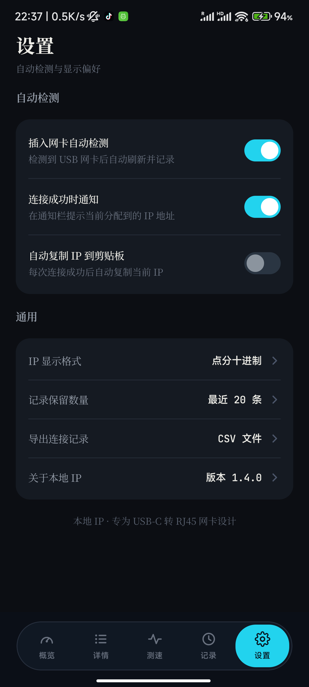
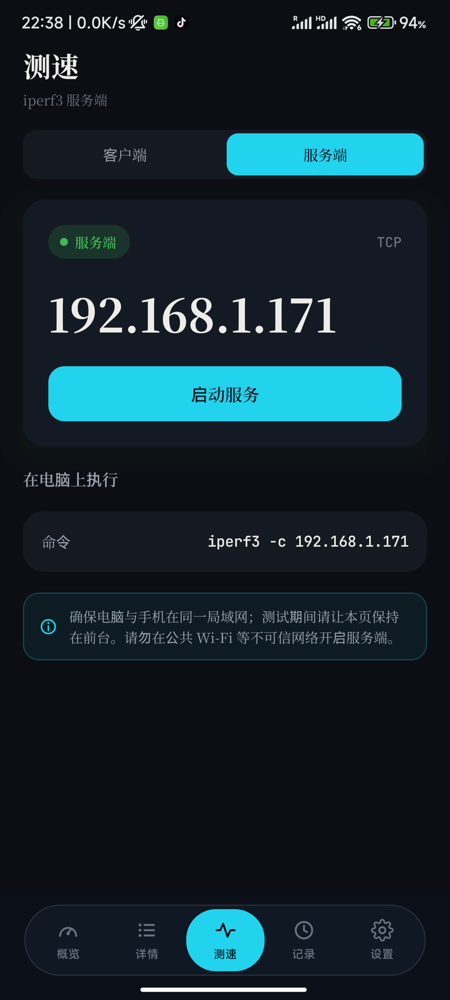

# 本地 IP · Local IP

> 一个 Android 小工具：**插上 USB-C 转 RJ45 网卡，立刻看到路由器分配给你的那个 IP**。
> 附 iperf3 局域网测速。
>
> An Android utility that shows the LAN IP assigned to your **USB-C to Ethernet adapter**,
> plus a built-in iperf3 speed test.

[](LICENSE)
[](#)
[](https://kotlinlang.org)
[](https://developer.android.com/jetpack/compose)

---

## 为什么做这个

用 USB 网卡（Type-C 转 RJ45）调试设备时，最烦的一步是**确认到底拿到了哪个 IP**：

- 系统设置里翻半天，网络信息藏在多层菜单下；
- 插着网卡但 DHCP 还没完成时，系统显示的网络可能**还是 Wi-Fi**，让人误判；
- 想知道链路真实带宽，还得另开终端敲 iperf3。

这个 App 把这三件事收敛成一个即时可读的界面：**插上就有反馈，插拔状态一目了然**。

## 截图

| 概览 | 网络详情 | 测速 |
|---|---|---|
|  |  |  |

| 连接记录 | 设置 | 测速 · 服务端 |
|---|---|---|
|  |  |  |

## 功能

**概览** —— 四态状态机，一眼看出当前处境：

| 状态 | 表现 |
|---|---|
| 有线已连接 | 青色，大号显示路由器分配的 IP、链路速率、网卡型号 |
| 检测中 DHCP | 青色 + 骨架屏与进度步骤（网卡在但还没拿到 IP） |
| **未连接转接器** | 琥珀色，**仍然显示 Wi-Fi 的 IP**，并明确标注来源与提示 |
| 无网络 | 兜底引导 |

**网络详情** —— IPv4 / IPv6 / MAC、网关 / 子网掩码 / 首选与备用 DNS、连接速率 / MTU / 网卡型号。

**测速** —— 内置 **iperf3 3.22**，两种角色：

- **客户端**：连别人的 iperf3 服务器。TCP/UDP、下载/上传/双向、时长与并发流可调，实时速率 + 进度条，结果自动入库。
- **服务端**：手机当 server，直接给出本机 IP 和电脑端要执行的命令。

**连接记录** —— 自动保存最近 N 次连接并高亮当前连接，支持清空与导出 CSV。

**网关探测** —— 真实 ping 默认网关，显示平均/最小延迟与丢包。

**其他** —— 连接成功通知、自动复制 IP、IP 显示格式（十进制 / CIDR）、深色界面（严格还原设计稿）。

## 安装

从 [Releases](../../releases) 下载 APK 安装，或自行构建（见下）。

要求 **Android 6.0 (API 24) 及以上**、**arm64 设备**。

## 构建

```bash
# 需要 JDK 17 + Android SDK (platforms;android-35 / build-tools;35.0.0)
./gradlew assembleDebug          # macOS / Linux
gradlew.bat assembleDebug        # Windows
```

产物：`app/build/outputs/apk/debug/app-debug.apk`

```bash
adb install -r app/build/outputs/apk/debug/app-debug.apk
```

## 实现要点

几个踩过坑才搞对的地方，供参考：

### 1. 只看默认网络进不了「检测中」态

插着网卡但 DHCP 还没完成时，**系统默认网络仍然是 Wi-Fi**，所以单靠 `registerDefaultNetworkCallback`
永远看不到"网卡已插入、IP 待分配"这个中间态。

`NetworkMonitor` 用**三个信号源**合并成一条 Flow：

1. 默认网络回调 —— 拿"当前生效"的 IP / 网关 / DNS
2. **以太网专项请求** `registerNetworkCallback(TRANSPORT_ETHERNET)` —— 网卡一插上就回调，**不等 DHCP**
   （刻意**不加** `NET_CAPABILITY_INTERNET`，否则"网卡在但没配好"时不上报）
3. 2 秒轮询兜底 —— 部分 ROM 不上报尚未配好的以太网

### 2. 来源判断必须两层

```kotlin
if (caps.hasTransport(TRANSPORT_ETHERNET)) return ETHERNET       // ① 标志位
if (iface.startsWith("eth"|"usb"|"rndis"|"enp")) return ETHERNET // ② 接口名兜底
```

某些 ROM 会把 USB 网卡归成未知 transport，只信标志位就会出现「IP 明明有、界面却说未连接转接器」。

### 3. 「连接速率」的数据源分两种，语义完全不同

- **有线** → `/sys/class/net/<iface>/speed`（协商速率）
- **Wi-Fi** → 必须读 `WifiInfo`（`txLinkSpeedMbps` / `linkSpeed`），**这和系统设置里显示的是同一个数**

⚠️ 别对 Wi-Fi 用 `NetworkCapabilities.linkDownstreamBandwidthKbps` —— 那是按信号质量估算的**可用吞吐**，
不是射频协商速率，会明显偏低（实测 1200 Mbps 的链路只报 194 Mbps，和系统设置对不上）。

### 4. Android 10+ 起 `/sys/class/net` 会被 SELinux 拦

实测小米上报 `avc: denied { search } for name="net" dev="sysfs"`，于是**读不到网卡型号和协商速率**。

对策：网卡型号改用 `UsbManager` 的 **VID/PID 映射**反推（不碰 sysfs、不需要权限），
覆盖 Realtek RTL8152/8153/8156、ASIX AX88179/AX88772、Microchip LAN78xx 等常见桥接芯片。

### 5. 把 iperf3 可执行文件随 APK 分发

安卓系统里没有 iperf3，必须自带；而 App 私有目录（filesDir）是 **noexec** 的，解压过去也执行不了。
标准做法是伪装成「原生库」：

1. 放 `app/src/main/jniLibs/arm64-v8a/libiperf3.so`（**必须叫 `lib*.so`** 才会被打包）
2. `android:extractNativeLibs="true"`
3. `packaging { jniLibs { useLegacyPackaging = true } }`

安装后系统会把它解压到 `nativeLibraryDir` 并带上可执行权限，运行时用
`File(applicationInfo.nativeLibraryDir, "libiperf3.so")` 取路径。

iperf3 输出**不用 `-J`**（只在结束时吐一次 JSON，拿不到实时进度），改为解析文本区间行 + `--forceflush`。

### 6. ⚠️ 停止 iperf3 不能只靠协程取消

协程阻塞在 `InputStream.readLine()` 上是**线程阻塞，不响应协程取消**，`finally` 里清理不到进程
—— 点了"停止"进程还在跑，服务端会一直占着 5201 端口。

所以要持有进程引用并 `destroyForcibly()`。**但这样又会踩第二个坑**：强杀时阻塞中的 `read()`
**抛的是 `InterruptedIOException` 而不是返回 `null`**，读循环如果只有 `try/finally` 没有 `catch`，
异常就会穿透 flow 冒到 `viewModelScope.launch`，**直接把 App 搞崩**：

```
FATAL EXCEPTION: main
java.io.InterruptedIOException: read interrupted
    at java.io.BufferedReader.readLine(...)
```

正确姿势是两层防护：① 最内层把 `IOException` 吞掉视为正常结束；
② `collect` 前加 `Flow.catch {}` 兜底（它不捕获 `CancellationException`，不影响取消语义）。

> 这一条是**纯读代码推不出来**的 —— 只有真机跑一遍才暴露。

### 7. 动态文本不打包字体

只打包 **Noto Serif SC** + **JetBrains Mono**（并做了子集化，共 ~1.4 MB）；
SSID、网卡型号、接口名等**动态文本刻意走系统默认字体**，靠 Android 字体回退，从根上避免豆腐块。

## 已知限制

- **依赖 ROM 带 USB 以太网驱动**。可这样验证：`adb shell ip link`，插拔转接器对比是否多出 `eth0` / `usb0` / `rndis0`。
  实测小米 12S（Android 13）内置 `CONFIG_USB_RTL8152=y` / `CONFIG_USB_NET_CDCETHER=y`，
  并有 `asix.ko`、`ax88179_178a.ko`；但**未开启** RNDIS 与 SMSC95xx。
- **iperf3 只提供 arm64-v8a 构建**，其他架构会显示「未找到 iperf3 可执行文件」优雅降级，不影响 IP 相关功能。
- **服务端模式会绑定所有网络接口**（`[::]:5201`），请只在可信网络开启。
- 客户端测速连不上时**优先查对端防火墙**（Windows 需放行入站 5201）。
- **MAC 地址在 Android 10+ 可能返回 null**（隐私策略）→ 显示 `—`。
- **Wi-Fi 名称需要定位权限**，App 不主动索要，拿不到时界面只显示「WLAN」。
- 「插入网卡自动检测」开关**不能触发 DHCP**（DHCP 由系统完成），它控制的是"是否自动记录"。

## 第三方组件

详见 [THIRD_PARTY_NOTICES.md](THIRD_PARTY_NOTICES.md)。简要：

| 组件 | 许可 |
|---|---|
| [iperf3](https://github.com/esnet/iperf) 3.22（预编译二进制） | BSD-3-Clause |
| [Noto Serif SC](https://fonts.google.com/noto/specimen/Noto+Serif+SC) | SIL OFL 1.1 |
| [JetBrains Mono](https://www.jetbrains.com/lp/mono/) | Apache-2.0 |

iperf3 的 Android 预编译产物来自 [davidBar-On/android-iperf3](https://github.com/davidBar-On/android-iperf3)。

## 许可

[MIT](LICENSE) © 2026 bybixi
